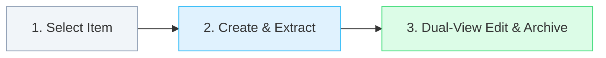

# Zotero MindFlow

**Zotero Flow Series · Knowledge**

*让研究的每一步衔接起来。 / Connect each step of research.*

Organize papers, annotations, and ideas into editable maps.

[简体中文](README.md) · [English](README.en.md)

[](https://github.com/groele/Zotero-MindFlow/releases/tag/v13.0.1) · [Download XPI](https://github.com/groele/Zotero-MindFlow/releases/download/v13.0.1/zotero-mindflow-13.0.1.xpi) · [Release Notes](docs/releases/v13.0.1.md) · [Report an Issue](https://github.com/groele/Zotero-MindFlow/issues)

[Overview](#overview) · [Installation and updates](#installation) · [Quick start](#quick-start) · [Key features](#features) · [In-depth highlights](#highlights) · [Settings](#settings) · [Data, sync, and services](#data) · [Compatibility and validation](#compatibility) · [Troubleshooting](#troubleshooting) · [Development and documentation](#development) · [The Flow series](#series) · [Origin and license](#license)

---

<a id="overview"></a>

## Overview

**Zotero MindFlow** is engineered for in-depth literature reading, critical synthesis, survey structuring, and academic knowledge organization. It bridges the divide between static library items and disconnected third-party mind mapping applications by integrating deeply into the native Zotero ecosystem. Researchers can synthesize literature, extract highlights, schedule milestones, and optionally leverage AI to draft structured concept maps directly within the workspace and native sidebar.

As an integral pillar of the **Zotero Flow** series, MindFlow operates completely standalone or in concert with companion add-ons to connect literature discovery, knowledge structuring, task progression, and academic citation.

---

<a id="installation"></a>

## Installation and updates

1. Download the official release package [zotero-mindflow-13.0.1.xpi](https://github.com/groele/Zotero-MindFlow/releases/download/v13.0.1/zotero-mindflow-13.0.1.xpi) (**current stable release v13.0.1**, 531,498 bytes; do not install the Source code ZIP).
2. In Zotero, navigate to **Tools → Plugins / Add-ons** from the top menu.
3. Click the **gear icon** in the top-right corner of the Add-ons Manager and select **Install Add-on From File...**.
4. Choose the downloaded `zotero-mindflow-13.0.1.xpi` file and restart Zotero when prompted.

> [!TIP]
> **Update Feeds and Verification**  
> - **Online Update Manifest**: Hosted as an immutable asset feed at [zotero/update.json](zotero/update.json) with Add-on ID `mindflow@groele.org`.  
> - **SHA-256 Checksum**: `9f184d7c33b1e3639a953050bc509d0a5fe938a36a3aa4b309cf1a4caaec4959`.  
> - Subsequent updates can be detected and applied directly through the Zotero Add-on Manager. Backing up the workspace before major version upgrades is always recommended.

---

<a id="quick-start"></a>

## Quick start

Construct your literature knowledge map in three seamless steps:



1. **Select Item & Open Map**: Highlight a paper in your Zotero library, expand the "Mind Map" section in the right ItemPane, and click **New Map**, or click the MindFlow wing icon on the main toolbar.
2. **Extract Material & Structure**: Choose an academic preset (such as "Paper Story"), extract item metadata, abstract, and annotations with one click, and expand your thoughts fluently using keyboard shortcuts (`Tab` for sub-nodes, `Enter` for siblings).
3. **Save & Archive**: Live edits are persisted automatically in the local workspace. Click **Archive to Zotero** on the toolbar to generate a dedicated `.mindflow` attachment bound permanently to the item, or export a standalone interactive HTML for distribution.

---

<a id="features"></a>

## Key features

| Differentiator | What it does | Boundary & Practical Guidance |
|---|---|---|
| **Bi-directional Canvas & Outline Views** | Visual canvas for expansive exploration and structured outline for high-speed linear input; features instant lossless view switching, global search/replace, and minimap. | Node notes support rich/plain text; map structures represent researcher mental models rather than automatic proof of causal claims. |
| **Native Item-Level Binding** | Each map binds unambiguously to a Zotero item, collection, or standalone topic; native ItemPane integration displays live map associations and quick actions. | File renaming does not disrupt internal bindings; when migrating libraries or merging duplicates, confirm the intended parent item before archiving. |
| **Academic Reading Presets** | Built-in frameworks including Paper Story (context → challenge → methodology → evidence → insights), Method Evaluation, and Critical Review, plus custom presets. | Presets provide scientific inquiry prompts; analytical depth remains governed by the researcher’s intellectual engagement. |
| **Durable Archive, Snapshots & Recovery** | Real-time write-safe local workspace with one-click `.mindflow` attachment archiving, multi-version snapshot rollbacks, and Schema v2 backup protection gates. | `.mindflow` attachments and PDFs are stored independently; check timestamps before restoring backups to prevent overwriting active edits. |
| **Portable Multi-Format Export Ecosystem** | Exports standalone **Interactive HTML** (self-contained with embedded vector styles and scripts for offline exploration), publication-grade **SVG**, high-res **PNG**, **Markdown**, **OPML**, and raw **JSON**. | Maps with heavy embedded image assets increase file sizes; generic format conversions (like OPML) may not preserve specific edge curvature styles. |
| **Optional AI Reading Drafts** | Connects seamlessly with the local `llm-for-zotero` runtime to synthesize structured reading drafts from abstracts, notes, and PDF pages without copying API keys. | MindFlow maintains no intermediary servers and stores no user credentials; AI outputs are presented as editable drafts requiring researcher verification. |
| **Optional WebDAV Workspace Backup** | Backs up the entire workspace to user-configured HTTPS WebDAV endpoints with version retention and cross-device restoration. | Core mapping and local archiving work fully offline; remote synchronization depends on provider quota and network stability. |

---

<a id="highlights"></a>

## In-depth highlights

### 1. Seamless ItemPane Native Integration
Unlike floating web popups, MindFlow conforms rigorously to native Zotero 10 / 11 / 12 design specifications:
- Dynamically responds to the selected library item or open PDF tab;
- Displays bound maps, thumbnail metadata, and modification timestamps directly within the right pane;
- Exposes direct shortcuts: "Open Map", "Append Sub-node", and "Import Notes";
- Seamlessly respects Zotero's adaptive light and dark themes using host-native CSS tokens.

### 2. Dual Canvas and Outline Modality
- **Canvas Mode**: Free-form spatial positioning, grid snapping, customizable connector aesthetics (smooth cubic Bezier, rounded orthogonal, straight line), rich-text node styling, priority tags, and relational cross-links.
- **Outline Mode**: Minimalist nested hierarchical tree built for lightning-fast keyboard-first outlining and tree restructuring.
- **Fluid Keyboard Navigation**:
  - `Tab`: Create child sub-node
  - `Enter`: Create sibling node
  - `Space` / `Enter`: Toggle collapse / expand branch
  - `F2`: Rename active node
  - `Delete` / `Backspace`: Remove node and its subtree
  - `Ctrl + F` / `Cmd + F`: Real-time canvas-wide search and replace

### 3. All-Inclusive Offline Interactive HTML Export (Killer Feature)
MindFlow's **Interactive HTML** export sets a new standard for academic sharing:
- **Zero-Dependency Single File**: Fully bundles vector layout rendering logic and styling without requiring Zotero or external internet connectivity;
- **Full Dynamic Interactivity**: Recipients can freely **pan**, **smooth-zoom**, and **expand/collapse subtrees** directly within any modern web browser;
- **High-Fidelity Task Markers**: Fully mirrors node task status badges (todo gray, in-progress blue, completed green), strike-through typography, and visual opacity.

### 4. Structured Reading Presets & Schema v2 Backup
- **Built-in Research Logic**: Built-in "Paper Story" template structures the inquiry flow: Research Background → Core Question → Proposed Mechanism → Experimental Proof → Limitations & Outlook;
- **Preset Portability**: In v13.0.0, the enhanced `schemaVersion: 2` backup protocol bundles user-defined research presets alongside document trees, seamlessly merging them upon restoration;
- **Version Guardrails**: A strict major version ceiling blocks inadvertent deserialization of future incompatible schemas, protecting your local knowledge repository from corruption.

---

<a id="settings"></a>

## Settings

Fine-tune every facet via **Zotero → Settings → Zotero MindFlow**:

| Category | Primary Preferences | Function & Timing |
|---|---|---|
| **General Preferences** | Window presentation mode (Standalone Window / Reader Split Pane)<br>Welcome onboarding guide | Controls whether maps open in a dedicated split pane or floating window; applies instantly. |
| **Canvas & Visuals** | Default layout engine (Mindmap / Logic Chart / Org Chart)<br>Curve style (Smooth Bezier / Orthogonal / Straight)<br>Canvas background (Grid / Dots / Blank)<br>Toolbar dock position (Top / Bottom / Left) | Configures visual hierarchy and geometric styling for new and active maps. |
| **Extraction & Literature** | Auto-extract abstract and metadata<br>PDF highlight capture threshold<br>Research template manager | Dictates extraction granularity when capturing nodes from items or open PDF annotations. |
| **Safety & Snapshots** | Auto-snapshot interval (1 ~ 120 minutes)<br>Max snapshots per document (10 ~ 50)<br>Workspace backup export / import | Enforces schema validation and clamped ranges, enabling one-click rollbacks to historical revisions. |
| **External Integration** | WebDAV endpoint and credentials<br>`llm-for-zotero` runtime bridge toggle | Sets up encrypted remote backup and optional AI draft generation. |

---

<a id="data"></a>

## Data, sync, and services

- **Local Workspace Storage**: Active maps are stored safely under `mindflow/workspace` in the Zotero data directory using atomic write safeguards. Local save commits to disk; explicit "Archive" creates item attachments.
- **Zotero Attachment Archiving**: Archived `.mindflow` attachments sync across devices through Zotero's native attachment sync mechanism (Zotero Storage or WebDAV).
- **Privacy & Data Security**:
  - MindFlow sends zero telemetry, personal documents, or private notes to unauthorized third parties;
  - The AI reading draft feature interfaces exclusively through the local `llm-for-zotero` runtime, meaning data flow is determined strictly by the user's local configuration.

---

<a id="compatibility"></a>

## Compatibility and validation

| Dimension | Specification & Verification Status |
|---|---|
| **Current Published Release** | **v13.0.1** (Patch Release) |
| **Declared Manifest Range** | Zotero `10.0` through `12.*` (`strict_min_version: 10.0`, `strict_max_version: 12.*`) |
| **TypeScript Static Check** | `npm run typecheck` (PASS, **0** errors) |
| **Frontend Unit Suite** | `npm test` (**111 / 111** tests PASS: 45 data pipelines + 36 core logic + 7 presets + 23 data integrity) |
| **Host Logic Regression** | `node --test scripts/test-host.mjs` (**89 / 89** tests PASS) |
| **Package & Update Feed Check** | `python scripts/test-release-package.py` (**8 / 8** tests PASS, payload hashes verified) |

---

<a id="troubleshooting"></a>

## Troubleshooting

<details>
<summary><b>1. Why doesn't a <code>.mindflow</code> attachment show up under the Zotero item after editing?</b></summary>

> MindFlow utilizes a dual-tier storage architecture:  
> - Editing continuously commits to a resilient local cache to safeguard against accidental crashes;  
> - To permanently anchor the map to your library item as a syncable sub-attachment, click **Archive to Zotero** on the workspace toolbar.
</details>

<details>
<summary><b>2. What should I do if the map workspace opens blank or fails to load?</b></summary>

> - Ensure you have not attempted to import backup files from a future major version (v13.0.0 includes a safety gate that blocks > v13 data to protect storage integrity);  
> - Navigate to **Settings → Safety & Snapshots** to restore from a recent snapshot, or recover your latest working tree via the Emergency Backup recovery tool.
</details>

<details>
<summary><b>3. The "AI Reading Draft" button does not respond when clicked.</b></summary>

> - MindFlow does not connect to cloud AI APIs directly; it leverages the `llm-for-zotero` runtime;  
> - Verify that `llm-for-zotero` is correctly installed, enabled, and configured with a working model in Zotero;  
> - Confirm that the selected literature item has a valid abstract or an accessible PDF attachment containing text.
</details>

---

<a id="development"></a>

## Development and documentation

Standard installation requires only the XPI. For developers building or extending the add-on locally:

```powershell
# 1. Install frontend dependencies
npm ci --prefix source

# 2. Run TypeScript type checks and unit tests
npm run typecheck --prefix source
npm test --prefix source

# 3. Build production assets
npm run build --prefix source

# 4. Run Zotero host simulation tests and package checks
node --test scripts/test-host.mjs
python scripts/test-release-package.py

# 5. Package XPI and sync feeds
python scripts/package-xpi.py --update-feeds
python scripts/package-xpi.py --verify-only
```

- [Audit Documentation Index](docs/README.md)
- [Release Notes v13.0.1](docs/releases/v13.0.1.md)
- [Brand & Product Specifications](docs/brand/PRODUCT.md)
- [Release Tag Policy](docs/release-tag-policy.md)
- [Historical Reference Guide & Acknowledgments](docs/reference/README.md)

---

<a id="series"></a>

## The Flow series

**Zotero Flow Series** unites individual research phases into a coherent workflow:

| Add-on | Core Role |
|---|---|
| [Zotero RefFlow](https://github.com/groele/Zotero-RefFlow) | **Literature Discovery** · Cross-reference citation graphs, connected papers, and one-click item ingestion. |
| [Zotero MetaFlow](https://github.com/groele/Zotero-MetaFlow) | **Metadata Optimization** · Validate, standardize, clean, and enrich academic metadata. |
| [Zotero ViewFlow](https://github.com/groele/Zotero-ViewFlow) | **Reading Preview** · Instant formatted citation previews and rich sidebar abstract exploration. |
| **Zotero MindFlow** | **Knowledge Organization** · Synthesize literature, annotations, and ideas into editable knowledge maps. |
| [Zotero TaskFlow](https://github.com/groele/Zotero-TaskFlow) | **Task Tracking** · Transform reading workflows and writing into structured milestones. |
| [Zotero CiteFlow](https://github.com/groele/Zotero-CiteFlow) | **Citation Tracking** · Manage and trace Microsoft Word citations linked directly to Zotero. |
| [Zotero PaperFlow](https://github.com/groele/Zotero-PaperFlow) | **Publication Management** · Track manuscript revisions, submission rounds, and peer review responses. |

*Note: Each add-on is installed and updated independently according to user preference.*

---

<a id="license"></a>

## Origin and license

- **Origin Notice**: Distributed as an independently maintained add-on within the Zotero Flow series; it is not a direct downstream fork of any single third-party mind mapping add-on. `llm-for-zotero` is an optional external runtime and not a derivative source of MindFlow's codebase.
- **License**: Released under the [MIT License](LICENSE).
- **Trademarks & Disclaimer**: An independent open-source project, not affiliated with or endorsed by Corporation for Digital Scholarship or Zotero. All third-party trademarks belong to their respective owners.
